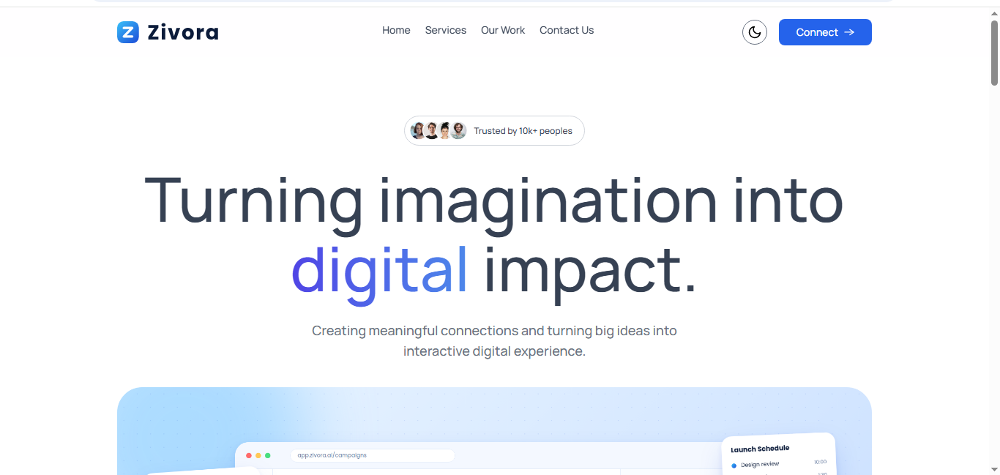
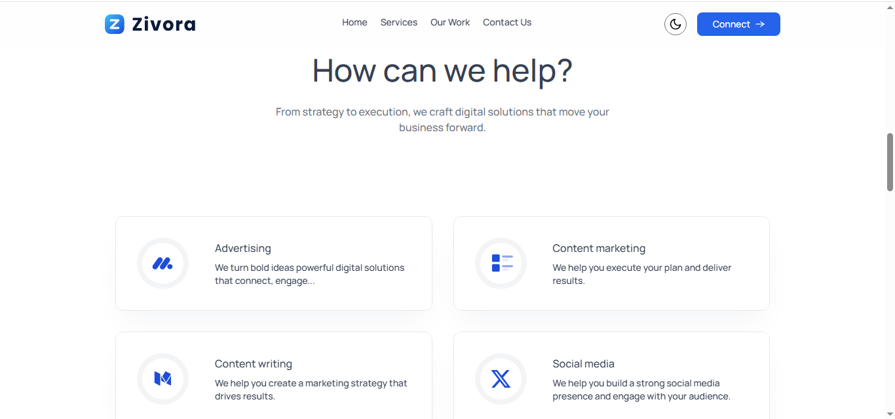
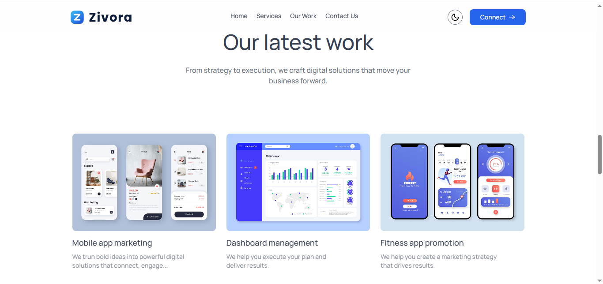
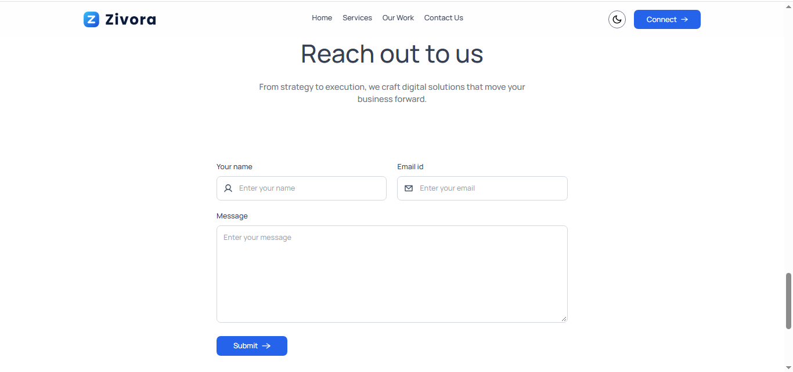

<div align="center">

# Zivora Digital Agency

**Turning imagination into digital impact.**

A modern, responsive agency website with smooth animations, dark mode and a working contact form.

[**Live Demo**](https://zivora-digital-agency.vercel.app) · [Report Bug](https://github.com/rajkumar-work-in/zivora-digital-agency/issues) · [Request Feature](https://github.com/rajkumar-work-in/zivora-digital-agency/issues)


</div>

---

## Preview

<table>
  <tr>
    <td align="center"><b>Home</b><br></td>
    <td align="center"><b>Services</b><br></td>
  </tr>
  <tr>
    <td align="center"><b>Our Work</b><br></td>
    <td align="center"><b>Contact</b><br></td>
  </tr>
</table>

## Features

- **Responsive design** that works on mobile, tablet and desktop
- **Dark and light theme** with a one-click toggle
- **Smooth animations** powered by Framer Motion
- **Services and portfolio sections** to showcase the agency's work
- **Contact form** delivered straight to email with Web3Forms, no backend needed
- **Reusable components** for easy maintenance and extension

## Tech Stack

| Category | Technology |
| --- | --- |
| Framework | React (Vite) |
| Language | JavaScript |
| Styling | Tailwind CSS |
| Animation | Framer Motion |
| Forms | Web3Forms |
| Hosting | Vercel |

## Project Structure

```bash
zivora-digital-agency/
├── public/
├── screenshots/
├── src/
│   ├── assets/
│   ├── components/
│   │   ├── ContactUs.jsx
│   │   ├── Footer.jsx
│   │   ├── Hero.jsx
│   │   ├── Navbar.jsx
│   │   ├── OurWork.jsx
│   │   ├── ServiceCard.jsx
│   │   ├── Services.jsx
│   │   ├── Teams.jsx
│   │   ├── ThemeToggleBtn.jsx
│   │   ├── Title.jsx
│   │   └── TrustedBy.jsx
│   ├── App.jsx
│   ├── index.css
│   └── main.jsx
├── index.html
├── package.json
└── vite.config.js
```

## Getting Started

**Prerequisites:** Node.js v18+ and a free [Web3Forms](https://web3forms.com/) access key.

```bash
# 1. Clone the repository
git clone https://github.com/rajkumar-work-in/zivora-digital-agency.git
cd zivora-digital-agency

# 2. Install dependencies
npm install

# 3. Add your environment variable (see below)

# 4. Start the development server
npm run dev
```

The app runs at `http://localhost:5173`.

### Environment Variables

Create a `.env` file in the project root:

```env
VITE_WEB3FORMS_ACCESS_KEY=your_access_key_here
```

> Keep `.env` out of Git by listing it in `.gitignore`.

## Scripts

| Command | Description |
| --- | --- |
| `npm run dev` | Start the development server |
| `npm run build` | Build for production |
| `npm run preview` | Preview the production build |
| `npm run lint` | Run ESLint |

## Deployment

The site is deployed on [Vercel](https://vercel.com/). To deploy your own copy, import the repository, add `VITE_WEB3FORMS_ACCESS_KEY` under **Settings → Environment Variables**, and deploy.

## Author

**Rajkumar J**, Java Full Stack Developer

[GitHub](https://github.com/rajkumar-work-in) · [LinkedIn](https://linkedin.com/in/rajkumar-work-in)

---

<div align="center">

If you like this project, please give it a star.

</div>
